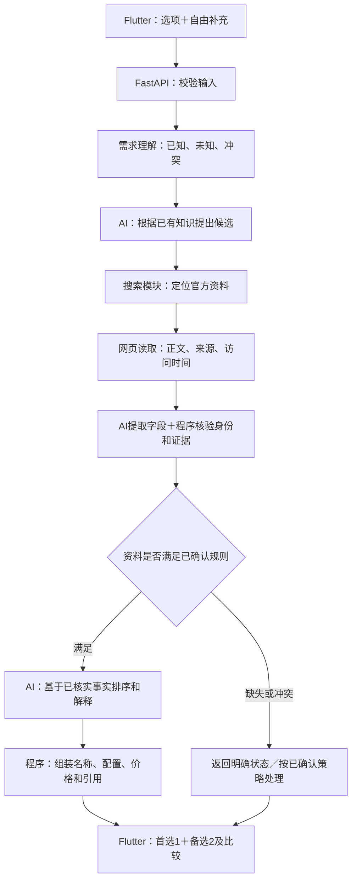

# AI 购买助手：第一版技术方案（AI 候选＋联网核实版）

- 更新日期：2026-10-11。
- 项目目录：C:\Users\派大星丶\Desktop\AI购买助手。
- 文档状态：依据最新需求重写的技术建议，尚未实现；模型／搜索供应商及未决业务规则不视为已经确认。
- 取代范围：本文件取代旧方案中的人工产品目录、产品数据库检索和 SQLite→PostgreSQL 产品库迁移路线。
- 保留方向：Flutter iPhone／Android 客户端，Python＋FastAPI 后端；计划先在 Mac 跑通接口，再接 App。

**推荐路线：AI 根据已有产品知识和用户需求提出候选 → 后端按次查找官方资料 → 核对具体型号、配置和价格 → AI 依据核实结果排序、解释 → App 展示购买建议。**

大白话讲：找一个了解产品的顾问，先听懂你想买什么，再列出他认为合适的几款，随后去厂商官网核对。你不用提前替顾问整理一本产品百科；但顾问不能把“我记得是这样”说成“官网已经证实”。

## 1. 已确定的范围与这次的变化

### 1.1 保留的产品需求

| 项目 | 第一版范围 |
| --- | --- |
| 目标用户 | 有购买意向，但对自己的需求和产品差异了解不足的人 |
| 品类 | 笔记本、手机、平板、显示器、耳机 |
| 输入 | 选项辅助＋自由补充；未知信息保持未知 |
| 推荐 | 正常成功结果为首选1款＋备选2款 |
| 理由 | 详细对应用户的选择和需求描述，说明适合处及取舍 |
| 价格 | 比较三款的官方参考价格 |
| 客户端 | Flutter，覆盖 iPhone／Android |
| 开发方式 | 先本机后端验证，再接 App，之后再考虑分享部署 |

### 1.2 新旧方案对照

| 事项 | 旧方案 | 新方案 |
| --- | --- | --- |
| 候选从哪里来 | 人工核实后导入的产品库 | AI 已有产品知识，结合本次用户需求提出 |
| 产品事实依据 | 预先整理的目录记录 | 本次联网取得的官方资料 |
| 你要做的维护 | 收集、核实、导入和更新商品数据 | 无需日常录入产品；仍需维护程序和核验规则 |
| 程序核对依据 | 数据库里的事实 | 本次请求中整理的网页证据和结构化事实 |
| 数据库 | SQLite，后续迁移 PostgreSQL | 推荐主流程不依赖产品数据库 |
| 资料更新 | 维护目录 | 用户发起推荐时按需查询 |
| 主要难点 | 目录覆盖及更新 | 搜索准确性、网页可读性、型号匹配和证据完整性 |

这里的联网是“针对本次候选，临时检索和读取官方资料”，不包含后台定时采集、全市场爬取、持续监控价格或建立长期知识库。即使代码里有网页读取，也不等于重新增加此前排除的自动更新价格系统。

AI 的记忆用于提出候选，不能用来证明型号存在或价格正确。按你目前描述，第一版不以发现全市场最新产品为目标；检索中发现模型没有提出的新型号，是否加入推荐范围仍需确认，不能默默扩大范围。

## 2. 建议的技术选型

以下是可实施的组合。框架延续已确认方向；具体服务账号、供应商和费用需要在接入前确定。

| 部分 | 建议技术／工具 | 为什么选择 | 用大白话说明 |
| --- | --- | --- | --- |
| 手机界面 | Flutter＋Dart，网络请求先用 http 包 | 延续双平台客户端；只负责输入、状态和结果展示 | 两种手机共用一套主要界面代码 |
| 后端接口 | Python＋FastAPI＋Uvicorn | 你熟悉 Python，适合组织模型调用和联网流程 | 接收 App 的请求，安排各模块工作 |
| 数据格式 | Pydantic 数据模型与显式校验规则 | 固定需求、证据、价格、结果的字段，减少前后端误解 | 给传递的每张表单规定栏目 |
| AI 服务 | 一家可用模型供应商的官方 SDK，封装 ModelGateway | 先接一家，避免同时维护多个供应商；以后可替换 | 顾问的大脑，负责理解、候选、排序和解释 |
| 搜索 | 搜索 API，封装 SearchGateway；可用 Brave Search API 做首个验证实例 | 返回链接及搜索信息，便于后端控制检索范围 | 帮顾问找到相关官方网页 |
| 网页读取 | HTTPX；HTML 解析先用 Beautiful Soup | 分开处理请求和正文解析，便于核验来源及失败原因 | 打开网页，把有用的文字／表格取出来 |
| 流程控制 | 普通 Python 服务函数＋asyncio，有限并发 | 这是一条明确流程，首版无需复杂代理框架 | 按检查单一步步做，同时查少量页面 |
| 配置 | JSON 配置文件＋环境变量 | 选项稳定 ID、核验规则和服务参数可独立维护 | 可调整的说明书，不是产品数据库 |
| 验证 | pytest＋模拟搜索／网页／模型返回 | 不花模型费用也能复现错价、错配置等问题 | 准备固定考题检查程序有没有改坏 |

Flutter 官方给出了 http 包的联网方式；iOS 开发工具仍按 Mac／Xcode 路线准备。[Flutter 网络请求](https://docs.flutter.dev/cookbook/networking/fetch-data)、[iOS 开发环境](https://docs.flutter.dev/platform-integration/ios/setup)。

FastAPI 的依赖机制可用于替换模型、搜索和网页读取实现；Pydantic 校验的是类型和约束，并不自动证明商品事实正确。[FastAPI 依赖](https://fastapi.tiangolo.com/tutorial/dependencies/)、[Pydantic 数据模型](https://docs.pydantic.dev/latest/concepts/models/)。

HTTPX 支持异步请求与连接、读取等超时设置；Beautiful Soup 用于解析 HTML。**解析库本身不会让动态网页变得可读。** 动态价格、登录后内容等需要单独评估，不能把读取失败当成商品没有价格。[HTTPX 异步请求](https://www.python-httpx.org/async/)、[超时设置](https://www.python-httpx.org/advanced/timeouts/)、[Beautiful Soup 文档](https://www.crummy.com/software/BeautifulSoup/bs4/doc/)。

### 联网方式的取舍

**推荐先做独立联网模块：搜索 API 找页面，网页读取模块拿正文，AI 提取信息，程序核验。**

优点是能看清查过哪些页面、哪些字段有依据，也便于替换供应商。代价是比“把问题直接交给一个联网模型”多写一些流程代码。

另一种可行接法是使用模型供应商内置的联网工具，减少搜索接入工作。前提是该服务能返回实际使用的来源、可核对的内容及工具调用状态；只有一段答案和几个链接，不足以满足字段核验。它应作为 SearchGateway／PageReader 的另一种实现，不改变 App 接口，不需要另造第二套产品。

Brave Search 的官方接口支持地区、语言和页面日期等检索条件，可作为独立搜索模块的验证例子；**这不等于已替你选定或购买该服务**。搜索结果里的摘要用来定位网页，不直接作为当前官方配置和价格。[Brave Search 文档](https://api-dashboard.search.brave.com/app/documentation/web-search)。

首版先选一条联网接法跑通。供应商是否能在你的开发和部署环境访问、能否读取五品类的官方页面，需要用样例实测，不能仅凭宣传页决定。

## 3. 架构与数据流



图里的“已核实”表示通过规定的证据和一致性检查，不代表系统能够证明每条网页内容绝对正确。补查次数必须有上限，不能在资料不完整时无限搜索。

| 模块 | 职责 | 不应混进去的工作 |
| --- | --- | --- |
| 输入与需求模块 | 解析选项、原文、未知信息和冲突 | 擅自补预算、用途或品牌偏好 |
| 候选生成模块 | AI 提出可能适合的型号与配置方向 | 把记忆价格直接当官方价 |
| 联网模块 | 搜索、筛来源、读取页面、记录读取结果 | 后台全量采集和永久入库 |
| 事实核验模块 | 对照产品身份、字段来源、地区和价格口径 | 用格式校验代替真实性检查 |
| 推荐模块 | 根据需求和本次证据排序、解释取舍 | 承诺覆盖全市场或绝对最优 |
| 结果组装模块 | 固定事实字段、引用和状态，计算同口径价格差 | 让模型在最后一步重写价格 |
| Flutter 展示模块 | 输入、加载、错误恢复、结果与来源查看 | 直接持有模型密钥、自己拼购买事实 |

推荐核心应是可以单独调用的 Python 函数／服务，不直接依赖 Flutter 页面或 FastAPI 请求对象。这样以后修改 UI、更换搜索服务或模型时，不必重写整个推荐逻辑。

## 4. 一次推荐具体怎样运行

### 第一步：把用户需求整理清楚

选项按稳定 ID 传递，显示文案可以改，含义变了要更新配置版本。自由文字保留原意，已提取的每条需求记录来自哪个选项或哪段原文。

例如“我想买笔记本，主要写文档，预算还没想好”只能得出品类和用途；预算必须继续未知，不能推断为某个价位。必要信息缺失时是否补问、补问什么，由待确认的业务规则决定。

### 第二步：AI 提出候选，但暂不发布购买建议

模型依据需求及自身知识提出一个规模受限的候选集合。候选数量上限是可调整的技术参数，不是最终只允许查三款。

候选至少包含品牌、型号线索、代际／年份线索及需要核实的配置。程序分配本次请求中的 candidate_id；模型不能自己创造“已经核实”的状态。

### 第三步：按候选查官方来源

后端根据型号线索、配置、目标销售地区组织查询。优先查官方产品页、规格页、官方价格页或官方公告；搜索可以帮助找到页面，但不能只看到标题就宣布核实通过。

应保留本轮访问过的真实 URL、页面标题、访问时间和读取结果。官方域名需要可审查的判定规则；维护少量域名及地区路径规则属于程序配置，不等于维护型号／价格目录。无法确认归属的域名标为未知，不能由模型一句“这是官网”直接通过。

### 第四步：把网页内容提取成字段，再检查

可以让 AI 从正文中提取字段，但必须同时返回证据片段定位。程序检查：

- 来源是否来自本轮实际获取的页面，引用片段是否存在。
- 页面描述的是不是同一个型号、代际和具体配置。
- 规格值是否有单位；“可选最高配置”是否被误当成当前配置。
- 价格对应的是不是这个配置、同一地区、币种和价格类型。
- 多个官方页面是否互相冲突，是否把公告日期当作本次价格生效日期。

价格优先从明确的文本／表格／结构化字段确定性提取；需要模型辅助时，同样要保留原始价格片段及配置关联，不能只相信模型吐出的一个数字。程序校验能拦截明确矛盾，仍不能完全消除模型误读。

### 第五步：用核实后的事实重新排序

模型只接收本轮允许使用的候选、事实引用和需求，不重新凭记忆补齐缺失字段。

联网核实可能推翻初始印象，例如原本以为某配置符合预算，核对后发现不符合。硬性约束必须重新检查，不能保留一开始的排序不变。预算软硬程度未知时不擅自替用户选择。

某候选查不到资料时，可以在已批准的范围和次数内补查；是否换候选、是否允许少于三款，需要按业务决策处理。不能为凑三款虚构商品。

### 第六步：程序组装结果，App 展示

名称、配置、价格从本轮结构化证据对象中取值。模型输出理由结构、需求引用和事实引用；理由里的商品数值、名称和金额也由程序填入，避免卡片价格正确、理由却偷偷写了另一个价格。

理由应区分“官方资料支持的配置事实”与“结合需求作出的适合性判断”。“内存为某容量”是事实；“对你的文档办公更合适”是判断。不能把“芯片更新”直接写成“对你必然更值得买”。

展示官方资料出处及访问时间用于核验，不设置购买按钮、商家跳转或带佣金链接。来源查看的具体界面样式不在本轮固定。

## 5. 不建产品库，但需要哪些数据结构

### 5.1 首版无需产品数据库

建议以**本次请求的内存对象**保存候选、页面证据和结果；请求结束后不形成可供未来检索的产品目录。因此这版不需要设计 products、variants、prices 长期表，也不需要为它们引入 SQLite、PostgreSQL 或向量数据库。

这是一种可行的实现建议，不代表“无账号、无强历史”已经被解释成所有会话和日志永不保存。是否保留当前输入、诊断记录、缓存及保留多久，仍需确认。没有数据库也不等于模型供应商和搜索供应商完全不留记录，服务侧的数据设置需在选型时核对。

| 数据 | 建议放在哪里 | 是否构成产品库 |
| --- | --- | --- |
| 选项、品类 ID、问题版本 | 项目配置文件 | 否，只定义怎样问需求 |
| 单次需求、候选、事实和证据 | 请求内存对象 | 否，不跨请求积累为目录 |
| App 本次编辑状态 | 客户端状态管理 | 否，重启是否保留待确认 |
| 模型／搜索密钥 | 后端环境变量 | 否，不能放 App 或代码仓库 |
| 测试样例 | tests/ 下隔离的虚构输入与模拟网页 | 否，仅验收程序，不能混入真实推荐 |
| 缓存、历史、日志 | 留存规则确定后再实施 | 不自动增加，不作为本版产品事实来源 |

即便以后用户变多，也不意味着必须恢复产品数据库。先评估请求状态、限流和日志有没有共享存储需求；只有确实新增持久化功能，再选择合适存储。

### 5.2 结构草图

这些是内存中的对象及 API 格式，不是要求建表。

| 对象 | 核心字段 | 用途 |
| --- | --- | --- |
| NeedProfile | category_id、option_answers、free_text、requirements、unknowns、conflicts、market_context | 表达用户需求，记录来源与未知项 |
| Candidate | candidate_id、brand_hint、model_hint、generation_hint、variant_hint、origin | 表示 AI 提出的待核实对象；origin 标明来自模型候选 |
| EvidenceDocument | evidence_id、url、final_url、title、fetched_at、page_date、fetch_status、content_hash、excerpts | 记录实际读到什么；page_date 可未知 |
| VerifiedFact | fact_id、candidate_id、field、value、unit、evidence_id、excerpt_locator、status | 每个配置字段单独有依据和状态 |
| PriceFact | candidate_id、amount_minor、minor_unit_digits、currency、region、variant_identity、price_basis、conditions、evidence_id、status | 把价格和具体配置、地区、口径绑在一起 |
| Reason | need_refs、fact_refs、conclusion_type、limitations | 表达哪些需求由哪些事实支持，避免无依据承诺 |
| RecommendationResult | request_id、status、primary、alternatives、comparison、evidence_sources、unresolved_items、checked_at | 给 App 的稳定结果结构 |

amount_minor 用最小货币单位整数保存，避免浮点金额误差；不能假定所有币种都是两位小数。价格未知使用空值加状态，不用0，也不用模型估价顶替。

同一商品身份应至少结合品牌、型号／代际、配置和地区核对；只有名称字符串相同不够。规格和价格页面可以不同，但必须能对应到同一个具体配置。

### 5.3 建议的内部状态

| 状态 | 含义 |
| --- | --- |
| supported | 当前字段已找到相符的官方证据并通过规定检查 |
| unknown | 没有足够资料作判断 |
| conflicting | 官方资料或配置关系互相冲突 |
| unavailable | 页面读取、搜索或服务调用失败 |

这些状态表示核验情况，不直接决定产品是否淘汰。尤其是“配置有依据但价格未知”，缺价策略没有确认前，不能把它写死成保留或剔除。

核实状态按字段记录：查到了配置，不代表价格也被核实；查到了一个价格，也不代表所有配置共用该价格。

## 6. 接口、目录与运行方式

### 6.1 建议的接口

| 接口 | 输入／输出 |
| --- | --- |
| GET /health | 服务是否启动，不顺带消耗模型或搜索调用 |
| GET /v1/categories | 五品类及稳定 ID |
| GET /v1/options?category_id=… | 该品类选项及配置版本 |
| POST /v1/needs/normalize | 单独查看需求解析结果，便于本机验收；App 不必重复调用 |
| POST /v1/recommendations | 原始选项、文字及已确认地区信息 → 完整流程结果或明确异常状态 |

推荐接口由后端重新解析、查询和校验；不能信任客户端自行提交的价格或“已核实”标记。客户端携带请求标识和输入版本，旧请求晚返回时不覆盖新需求结果。

本机原型先使用一次请求等待完整结果的方式，配置总时限；App 显示真实的加载／失败状态，不编造完成百分比。若真实耗时超过部署连接时限，再增加短期任务状态与轮询／事件流；此时需单独设计状态存放和过期规则，不提前引入队列与数据库。

### 6.2 建议的目录划分

```text
AI购买助手/
  backend/
    app/
      api/                 接口与请求转换
      core/
        needs/             需求整理
        candidates/        AI候选
        verification/      来源、身份和字段核验
        recommendation/    排序、理由和结果组装
      adapters/
        model/             模型服务
        search/            搜索服务
        pages/             网页获取与解析
      schemas/             输入、证据和结果格式
      config/              选项、规则和参数
    tests/                 模拟网页／模型与真实服务冒烟验证
  mobile/                  Flutter
  docs/                    方案、决策与运行说明
```

目录是建议，尚未创建应用工程。模型、搜索和网页读取模块通过统一接口被核心调用；更换一个供应商时尽量只修改对应 adapter。

### 6.3 本机到分享

先在 Mac 启动 FastAPI，通过接口文档验收；之后 Flutter 分别连接 iOS／Android 模拟器与真机。iOS 的工具和签名配置依照 Flutter 官方说明执行，不把 Windows 上保存本文等同于已经具备 iOS 构建环境。[Flutter iOS 配置](https://docs.flutter.dev/platform-integration/ios/setup)。

多人使用阶段增加 HTTPS、服务端密钥管理、请求限流、并发限制和费用观察。它们是分享准备工作，不是现在就购买云服务或上架 App 的授权；不再沿用“分享之前必须把产品库迁移 PostgreSQL”的旧前置条件。

## 7. 联网核验最容易出错的地方

| 问题 | 实现要求 |
| --- | --- |
| 搜索摘要已过时 | 摘要仅用于找页面；记录本次实际读取结果，不把搜索抓取时间说成价格生效时间 |
| 同系列不同配置串价 | 同时核对代际、尺寸、内存／容量等关键配置；不只按简称匹配 |
| 起售价冒充所选配置价 | 记录 price_basis 和条件；起售价、分期月供、以旧换新、教育价不能自动替代同口径参考价 |
| 地区和币种不同 | 地区、币种未知时保持未知；未经确认不跨币种换算或比较 |
| 官方新闻稿不是当前售价 | 页面日期、价格类型、本次访问时间分别保存 |
| 网页依赖脚本或不能访问 | 记录 unavailable；可换另一官方来源，仍失败则返回状态，不靠模型记忆补齐 |
| 页面只列“最高可选”参数 | 不把选配上限拼成一个不存在或不同价格的配置 |
| 来源之间冲突 | 保留冲突记录；不把多个不同版本页面的优点拼成一款产品 |
| 理由里重新写错数值 | 事实使用引用和程序回填，模型原始长文不直接当最终事实展示 |
| 网页里混入指令 | 页面内容只作为资料，不能更改候选范围、调用规则或执行程序 |

联网模块还应只访问允许的公开网页，检查最终重定向地址，拒绝本机／内网地址、非网页协议和过大响应。域名判断用解析后的主机名及明确规则，不能用“字符串里含品牌名”判断官网。这些检查应集中在网页访问模块，避免后续改代码时漏在某个调用入口。

首版不通过模拟登录、绕过验证或自动浏览器集群解决所有网页问题。先测简单读取的覆盖率；如关键官方页面确实需要浏览器渲染，再单独评估引入工具的成本和范围。

## 8. 速度、费用和可靠性的取舍

联网推荐通常比直接让模型回答多了搜索、读页面和核验步骤。本次没有进行真实供应商联调，因此不承诺固定响应秒数、单次费用或覆盖率。

建议把以下参数放到配置中：候选上限、搜索调用上限、页面数量上限、每页体积上限、单次调用超时、整次请求时限、重试次数、并发数和模型输出上限。只对适合重试的暂时性错误重试，资料缺失和配置冲突不能靠无限重试解决。

可以用 asyncio 管理有限并发和总时限；HTTPX 的网络超时不能替代整个推荐任务的总时限。[Python 异步任务](https://docs.python.org/3/library/asyncio-task.html)、[HTTPX 超时](https://www.python-httpx.org/advanced/timeouts/)。

单次成本可按“模型输入／输出用量＋搜索调用＋可能的网页读取服务费用”记录。供应商价格、账户可用性和额度以接入时核对为准；限流只是控制请求次数，不等于严格限制金额。关闭 App 或取消请求也不保证已发给供应商的调用不会计费，后端应尽可能停止后续工作。

| 优点 | 相应代价 |
| --- | --- |
| 不需要人工准备产品目录，可以更快验证产品价值 | 每次更依赖联网服务和官方页面可读性 |
| 可在推荐当次查资料 | “当次查询”不等于网站内容一定最新、完整 |
| 有来源可解释、可检查 | 抽取、身份核对和价格口径需要专门实现 |
| 产品数据无需日常录入 | 无法承诺覆盖全部型号，AI 初始候选可能遗漏 |
| 核心与供应商解耦 | 比单个大提示词多一些工程工作 |

**方案承诺应落在可验证行为上：实际查询、保留来源、按字段记录状态、不把未知当事实。不能承诺“永不幻觉”“一定找到三款”或“必然推荐全市场最优”。**

## 9. 建议的验证顺序

这部分是新方案的里程碑。已据此重排为[联网核实版68项开发任务清单](AI购买助手_开发任务清单.md)，每项含前置依赖与操作验收；任务编号不沿用旧61项清单。

1. **确认影响流程的规则。** 优先确定价格地区／币种／口径，以及缺官方价、候选不足、信息冲突如何处理。未定项可以先在内部模拟为状态，不能擅自变成真实用户策略。
2. **建立无数据库的后端骨架。** 健康接口、需求／证据／结果结构、独立核心函数先跑通。
3. **用模拟返回串起流程。** 以虚构候选和模拟网页验证字段关联；不把测试文件当真实商品库。
4. **接入真实模型与搜索，先测一个品类。** 用少量明确配置的样例核对网页读取和字段证据。先测一类是开发顺序，五品类仍是首版范围。
5. **扩展到五品类并检验错误路径。** 分别覆盖无价、错配置、过期页面、不同地区、读取失败和候选不足。
6. **连接 Flutter。** 验证输入、加载、首选／备选、理由与价格，旧请求不能覆盖新结果。
7. **本机完整验收后再准备分享。** 真机、网络、限流和费用保护分别验收，不沿用旧产品库迁移步骤。

建议至少保留以下验收案例：

| 输入或故障 | 应验证的行为 |
| --- | --- |
| 用户说“预算还没想好” | 预算仍未知，不生成虚假的预算条件 |
| 模型声称型号存在，但找不到可对应的官方资料 | 不标记为已核实；最终处置依确认规则 |
| 同型号两个配置价格不同 | 每个价格只对应其证据支持的配置 |
| 搜索摘要有价，打开网页未找到 | 不把摘要价升级为已核实官方价 |
| 官网只出现起售价或分期月供 | 标记真实价格类型，不当作所选配置总价 |
| 某款配置核实通过、价格未知 | price状态未知，最终保留／剔除策略待确认 |
| 页面对同一字段有冲突 | 保留冲突，不拼接出一个看似完整的虚假配置 |
| 理由夹带没有证据的金额或型号 | 结构校验／事实组装拒绝其直接展示 |
| 搜索超时、模型超时、额度不足 | 在已配置时限内结束，给明确状态，不伪造成功 |
| 连续提交需求A和B，A最后返回 | App仍显示与当前需求B对应的结果 |

固定样例验证程序规则；真实联网样例验证覆盖率与语义。真实模型不要求每次推荐顺序完全相同，但事实引用、硬约束和异常规则必须满足。

## 10. 旧文档和任务如何调整

| 旧内容 | 新方案的处理 |
| --- | --- |
| 人工采集、核实、导入五品类目录 | 从首版移除，换成按次联网证据获取 |
| products／variants／prices 表和导入工具 | 不再作为推荐依赖 |
| 产品目录 SQLite 备份及 PostgreSQL 迁移 | 不沿用；未来存储按新增真实需要决定 |
| “只能从已有目录筛候选” | 改成 AI 提候选，联网核实后进入排序 |
| “程序从数据库填名称和价” | 改成从本次通过核验的事实对象填入 |
| 稳定 ID 选项、需求结构、AI 适配、错误处理 | 思路保留，按新输入／输出重新检查 |
| Flutter 与后端分离、本机先跑接口 | 保留 |
| 原61项开发清单 | 已由联网核实版68项清单替代，旧版保留备份；旧数据库和资料录入任务不再沿用 |

旧版61项清单中的任务05、09—12、20—23、31—37、54—56等曾涉及人工目录路线，这些旧编号不再用作开发依据。2026-10-11已完成全部任务的重新拆解与依赖复核，当前执行入口为[联网核实版开发任务清单](AI购买助手_开发任务清单.md)。清单目前全部待执行，文档更新不代表软件已经实现。

## 11. 仍需你确认的事项

这些是产品规则和服务决策，本方案不擅自补齐。

| 待确认项 | 为什么影响实现 |
| --- | --- |
| 查不到官方价时保留并标缺失，还是不纳入并继续找 | 决定推荐资格、价格比较和失败流程；这是上一轮尚未回答的问题 |
| 价格地区、币种、税费及“当前官网价／上市参考价”等口径 | 决定查哪些页面，以及三款能否直接比较 |
| 有效候选不足三款、需求冲突或必要信息未知 | 决定补问、少给几款、继续找或停止 |
| 同型号不同配置可否占用不同推荐名额 | 决定去重和结果结构 |
| 检索中新发现、未由AI最初提出的型号是否可加入 | 决定是否扩大当前“AI已有知识提出候选”的范围 |
| 当前编辑内容、原始需求、日志、缓存是否保存及多久 | 决定最小留存与状态管理；不默认建立历史库 |
| 模型／搜索服务、调用预算、可接受等待时间 | 决定供应商、调用上限、交互与部署方式 |

未决策略在代码设计上用明确的策略入口和状态表达，不设置悄悄生效的业务默认值。它们不阻塞本文完成；实现对应真实路径前需要补齐决策。

## 12. 你以后自己改代码最容易踩的坑

1. **为了省事，把核验流程改成一句“请保证准确”。** 提示词不能代替真实查询和字段检查；始终保留来源对象、状态和程序校验。
2. **只修改卡片价格，忽略推荐理由。** 理由中的型号、配置和金额也从同一事实对象填入，不能让两处各写一份。
3. **把型号简称当唯一身份。** 改匹配规则时同时检查配置、代际和地区，保留“同名不同配置”的回归样例。
4. **把读取不到理解为不存在。** 超时、动态网页和缺资料是不同原因，不能都变成“这款没有官方价”。
5. **改选项文案时顺手改稳定 ID。** 旧输入和解析规则会错位；文案与含义分开，改变含义就更新版本及验收。
6. **修改字段只改 Python，不改 Flutter。** 数据结构和样例要同步；未知值不转成0或空白成功。
7. **把可变候选／证据放进所有请求共用的全局变量。** 容易把A用户需求配到B用户结果；每次请求独立保存，共享只用于明确设计的无用户数据配置。
8. **以为“多试几次”没有代价。** 搜索、模型和网页读取各自重试会相乘；统一管理次数、总时限和费用观测。
9. **缓存越写越多，最后悄悄变成产品知识库。** 首版不依赖跨请求产品缓存；以后新增必须单独确定目的、过期、口径和留存。
10. **把外部服务或安全逻辑散落到页面和业务函数。** 模型／搜索调用、密钥、地址校验集中在适配模块，保留替换接口和失败测试。

用一句话定位技术方案：**用 Flutter 和 FastAPI 做一个按需联网的购买顾问，AI 负责理解、提出候选与解释，程序负责组织官方证据和明确表达不确定性，第一版不建设产品数据库或知识库。**
