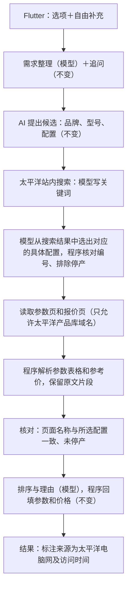

# AI 购买助手：技术方案变更（太平洋电脑网数据源）

- 变更日期：2026-10-11
- 依据：D-09（`docs/decisions.md`）。
- 适用范围：本文件替代《技术方案（AI 候选＋联网核实版）》中“到官方渠道联网核实参数和价格”的部分。需求整理、AI 候选、排序与理由、结果组装、Flutter 客户端的设计不变。
- 状态：方案已确定，代码尚未按本方案改造；对应任务见《开发任务清单》。

## 1. 为什么改

用阿里云 CleverSee 测试时，即使把搜索限定在华为官网和京东站点，返回的链接也都不是具体产品的页面，无法据此读取参数和价格。太平洋电脑网产品库的页面细到具体配置，结构规整，可以直接读取，所以改为以它为主要数据来源。

## 2. 太平洋电脑网产品库的页面（2026-10-11 实际查看）

| 页面 | 网址规律（以华为 MateBook 14 一个配置为例） | 内容 |
| --- | --- | --- |
| 站内搜索 | `https://ks.pconline.com.cn/product.shtml?q=关键词` | 匹配的具体配置列表，每条有名称、主要参数摘要，停产的标“停产” |
| 配置概览 | `https://product.pconline.com.cn/notebook/huawei/2225419.html` | 名称、重点参数、参考价 |
| 参数页 | 同一编号加 `_detail`，如 `2225419_detail.html` | “详细参数”表格：上市时间、处理器、内存、硬盘、屏幕、电池、接口等 |
| 报价页 | 同一编号加 `_price`，如 `2225419_price.html` | “参考价：￥7399（行货价格）”，以及经销商报价 |

特点：

- 每个具体配置（如“酷睿 Ultra 5 125H/16GB/512GB”）有单独的编号和页面，参数和价格天然对应到具体配置，不会把同型号不同配置的价格串在一起。
- 页面是普通 HTML，不需要浏览器渲染就能读到参数表格。
- 网址中的品类目录（如 `notebook`）和品牌目录（如 `huawei`）可以用来核对品类和品牌。

需要实测确认（任务 24）：

- 站内搜索的准确度。用 “MateBook 14 2024” 搜索时，返回的是两款已停产的 MateBook D 14，没有出现 MateBook 14 本身，搜索词的写法需要调整。
- 中文关键词的编码。网站文档里的示例链接按 GBK 编码中文（`%C6%BB%B9%FB` 是“苹果”），需要确认 UTF-8 编码是否也能用。
- 五个品类（手机、笔记本、平板、显示器、耳机）各自的目录名和页面结构是否一致。

## 3. 新的推荐流程

| 步骤 | 交给模型 | 程序负责 |
| --- | --- | --- |
| 搜索关键词 | 为每个候选写站内搜索关键词 | 控制搜索次数上限 |
| 选出具体配置 | 判断哪条搜索结果对应候选；都不对应时回答“没有” | 核对所选编号确实在本次搜索结果里；排除停产；品类目录与需求品类一致 |
| 参数 | 不需要 | 解析“详细参数”表格，每个字段保留“字段名 \| 值”原文作为证据；“暂无数据”“视使用环境而定”记为未知 |
| 价格 | 不需要 | 从报价页解析“参考价：￥X（行货价格）”，换算为整数“分”；没有参考价记为未知；经销商报价不用 |
| 排序与理由 | 依据解析出的参数和价格排序、写理由 | 核对引用，回填数值和金额（不变） |

参数和价格由程序直接解析，是因为太平洋的页面本身就是规整的表格，程序解析比模型提取更稳定，也更便宜。

## 4. 保持不变的原则

- 参数和价格只来自本次实际读取的太平洋页面，不用模型记忆补齐。
- 搜索结果列表上的摘要只用来定位，不当作事实；参数以参数页为准，价格以报价页为准。
- 读不到、没有参考价、页面名称对不上时，明确标为未知或失败，不编造。
- 网页访问安全检查（任务 21）、24 小时页面缓存（任务 62）、每次请求的证据相互隔离（任务 30）继续使用。
- 结果中不提供购买链接。来源链接指向太平洋电脑网的参数页和报价页，仅供核对。

## 5. 结果展示的变化

- 价格名称改为“参考价（行货价格）”，并注明“来源：太平洋电脑网”和访问时间。
- 三款候选的价格都来自同一来源、同一口径，可以直接比较差价。
- 推荐理由中的参数事实同样标注来源。

## 6. 对模块和费用的影响

| 部分 | 变化 |
| --- | --- |
| 阿里云 CleverSee | 暂不接入（D-09），不再产生搜索费用 |
| 官方渠道规则（任务 23）、渠道检索（任务 29 旧版） | 代码保留，不在主流程中使用 |
| 新增：太平洋站内搜索适配 | 读取站内搜索结果页，解析出配置名称、编号、网址、是否停产 |
| 网页访问范围 | 主流程只访问 `ks.pconline.com.cn` 和 `product.pconline.com.cn` |
| DeepSeek | 仍需要，用于需求整理、追问、候选、搜索关键词、选择配置、排序和理由 |

## 7. 风险与待办

| 风险 | 处理 |
| --- | --- |
| 数据不是官方数据，可能有错（如厚度、接口写法与官网不一致） | 结果中明确标注来源；以后如需要，可再接入官方渠道核对 |
| 网站声明未经授权禁止转载、摘编、复制 | 当前只用于本机原型；正式公开发布前必须先取得授权（发布前待办） |
| 站内搜索不准，找不到对应配置 | 搜索词由模型按网站命名习惯改写；找不到的候选按 D-02 处理，不虚构 |
| 网站改版导致解析失败 | 解析失败时明确返回失败状态；解析规则集中在一个模块里，便于修改 |
| 新机型收录滞后 | 只能推荐产品库里已有的配置；结果中写明数据来源和访问时间 |
